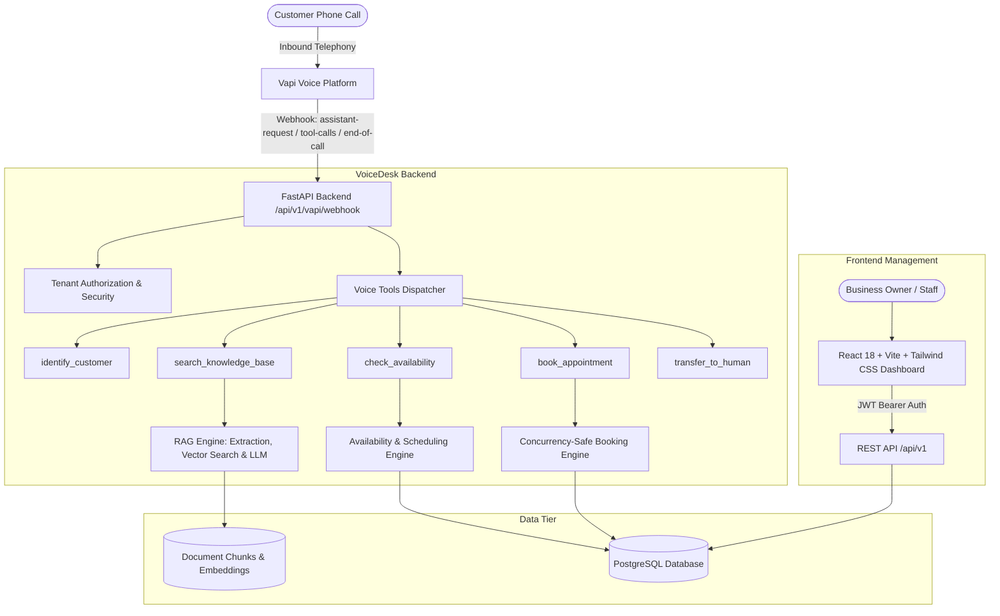
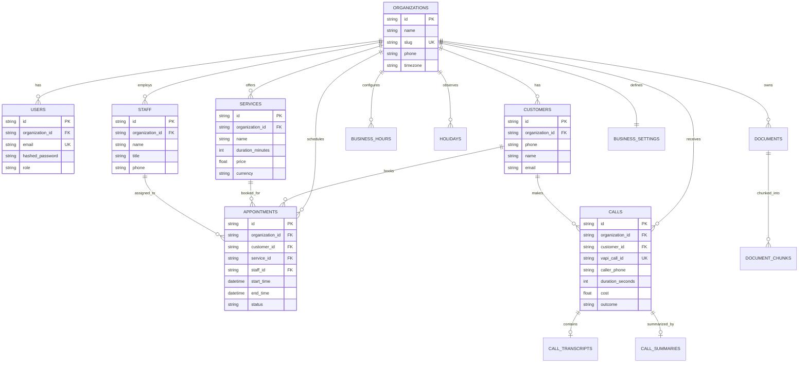

# VoiceDesk — AI-Powered Voice Receptionist

**VoiceDesk** is a multi-tenant, enterprise-grade AI inbound voice receptionist SaaS built for appointment-driven businesses including medical clinics, dental practices, salons & spas, educational institutes, and service agencies.

It natively integrates with **Vapi** for inbound telephony and automated function calling, features a **RAG Knowledge Assistant** with prompt injection defenses, provides a **concurrency-safe appointment booking engine** that prevents double bookings, and delivers an intuitive, full-featured **React/TypeScript dashboard**.

---

## 1. System Architecture



---

## 2. Database Entity Relationship (ER) Diagram



---

## 3. Core Features

### A. Vapi Voice Tools Integration
VoiceDesk implements the official Vapi tool-calling protocol (`message.type == "tool-calls"`) with 10 backend tools:
1. `identify_customer`: Queries tenant records by caller phone number to pull previous appointments and notes.
2. `search_knowledge_base`: Semantic vector search grounded strictly in uploaded documents.
3. `get_business_information`: Provides operating hours, business address, and policies.
4. `get_services`: Queries active services, prices, and durations.
5. `check_availability`: Calculates genuine available time slots by consulting business hours, staff schedules, and existing bookings.
6. `book_appointment`: Books confirmed appointments with database transaction locks to prevent double-booking.
7. `reschedule_appointment`: Atomically moves appointments to open slots.
8. `cancel_appointment`: Cancels appointments with customer-provided cancellation reason.
9. `create_customer`: Creates new customer profile during call.
10. `transfer_to_human`: Triggers carrier transfer to on-call staff with full reason logging.

### B. Concurrency-Safe Booking Engine
- Prevents overlapping bookings for the same staff member and time slot using database transaction boundary checks (`with_for_update` on PostgreSQL).
- Applies configurable business hours (0=Mon to 6=Sun), holidays/closures, minimum booking notice hours (e.g., 2 hours), buffer times between appointments (e.g., 10 minutes), and maximum advance booking limits.
- Timezone-aware storage (defaults to `Asia/Kolkata` with full multi-timezone support).

### C. RAG Knowledge Assistant & Security
- Supports `.pdf`, `.txt`, `.md`, and `.csv` document uploads.
- **Prompt Injection Defense**: Scans, sanitizes, and neutralizes prompt-injection triggers (e.g., `ignore previous instructions`, `DAN mode`, `reveal system prompt`).
- **Grounded Responses**: If the knowledge base does not contain an answer or confidence is low, the assistant acknowledges the limitation and suggests connecting with staff rather than hallucinating prices or facts.
- **Tenant Vector Isolation**: Embeddings and chunks are strictly isolated by `organization_id`.

### D. Multi-Tenant Architecture
- Every business has completely isolated customers, staff, services, appointments, calls, and documents.
- Organization identity is derived exclusively from the authenticated JWT token or verified provider metadata—never trusted from arbitrary frontend parameters.

---

## 4. Automated Test Suite

VoiceDesk includes 17 automated tests covering all critical paths:

```bash
cd backend
pytest -v
```

| Test File | Test Cases | Scope |
|---|---|---|
| `test_database.py` | `test_database_initialization` | SQLAlchemy models, relational cascades, migrations |
| `test_auth.py` | `test_register_and_login` | User registration, password hashing, JWT tokens, refresh |
| `test_tenant_isolation.py` | `test_tenant_isolation_authentication` | Verification that Org A cannot access Org B |
| `test_customers_services.py` | `test_customer_crud_and_duplicate_prevention`<br>`test_services_and_staff_crud`<br>`test_business_settings_and_hours` | Phone normalization, duplicate prevention, staff, hours |
| `test_appointments.py` | `test_availability_calculation`<br>`test_booking_and_double_booking_prevention` | Slot generation, double-booking prevention, reschedule/cancel |
| `test_rag.py` | `test_document_upload_and_rag_query`<br>`test_prompt_injection_protection`<br>`test_rag_tenant_isolation` | PDF/TXT extraction, injection sanitization, tenant isolation |
| `test_vapi_webhooks.py` | `test_vapi_health`<br>`test_vapi_assistant_request`<br>`test_vapi_voice_tool_calls`<br>`test_vapi_end_of_call_report_and_idempotency` | Vapi webhook protocol, tools execution, idempotency |
| `test_end_to_end.py` | `test_full_inbound_voice_call_lifecycle` | Complete round-trip lifecycle from call to dashboard update |
| `test_dashboard_analytics.py` | `test_dashboard_overview_and_activity` | Live metrics, peak calling hours, resolution rates |

---

## 5. Local Setup & Deployment

### Option 1: Native Local Running (Quickstart)

#### 1. Backend (FastAPI)
```bash
# Clone and enter repository
cd backend

# Create and activate Python virtual environment
python -m venv venv
# On Windows:
.\venv\Scripts\activate
# On Linux/macOS:
source venv/bin/activate

# Install dependencies
pip install -r requirements.txt

# Run migrations
alembic upgrade head

# Start backend server (runs on port 8000)
uvicorn app.main:app --host 0.0.0.0 --port 8000 --reload
```
Interactive Swagger API docs available at: `http://localhost:8000/api/v1/docs`.

#### 2. Frontend (React + Vite)
```bash
cd frontend

# Install dependencies
npm install

# Start development server (runs on port 5173)
npm run dev
```
Open your browser at `http://localhost:5173`.

---

### Option 2: Docker Compose

```bash
docker-compose up --build
```
This spins up:
- PostgreSQL 16 database on port `5432`
- FastAPI backend on port `8000`
- Nginx-served React frontend on port `5173`

---

## 6. Live Demo Walkthrough Guide

To test the application from end-to-end:
1. **Register Business**: Go to `http://localhost:5173/login`, click **"Quick Demo: Dental Clinic"**, and submit registration.
2. **Review Services**: Navigate to **Services**; observe default service with duration and price. Add new services as desired.
3. **Configure Operating Hours**: Go to **Availability**; view weekly open/close hours and add scheduled closures.
4. **Upload Knowledge Document**: Go to **Knowledge Base**, click **"Upload Demo Knowledge Document"**; observe instant extraction, chunking, and embedding generation.
5. **Test Grounded RAG**: Type a question in the **Live Semantic Query Tester** (e.g., *"How much does teeth whitening cost?"*); inspect the verified response and source citation.
6. **Simulate Inbound Voice Call**: Go to **Voice Agent**, select scenario *"Appointment Inquiry & Booking Workflow"*, and click **"Run Inbound Test Call"**; observe real-time tool execution (`identify_customer` -> `check_availability` -> `book_appointment` -> `end-of-call-report`).
7. **View Appointments & Calendar**: Switch to **Appointments**; verify the booked slot in Day/Week/Month view. Test **Reschedule** or **Cancel**.
8. **Inspect Call Intelligence**: Switch to **Call Logs**; click on the call to view duration, outcome, and full transcript.
9. **Inspect Analytics**: Navigate to **Analytics** or **Dashboard**; view live KPIs computed from database records.
